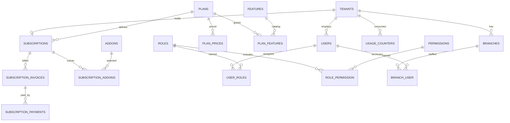
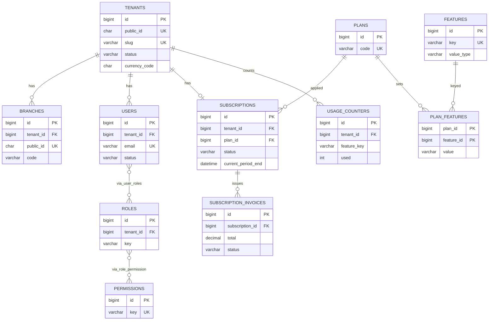
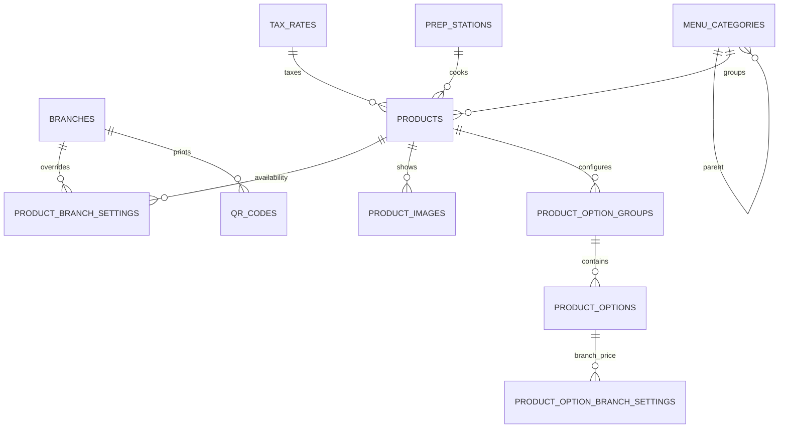
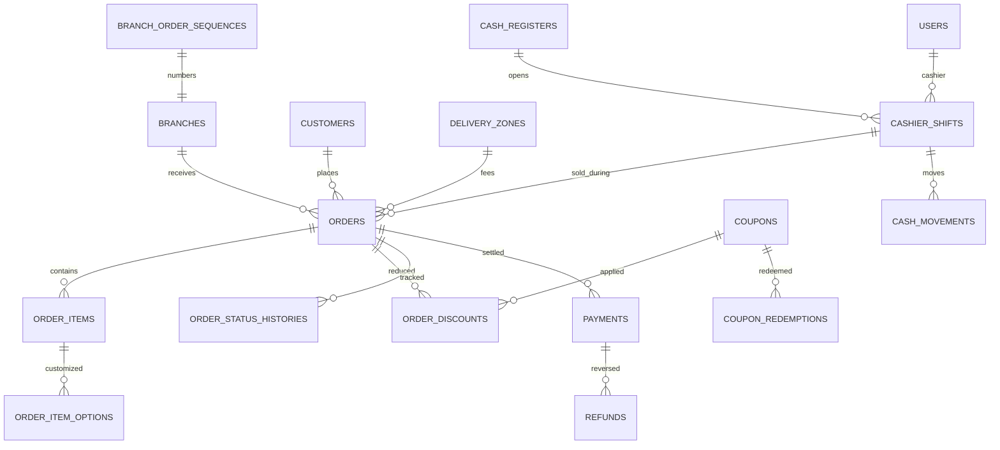
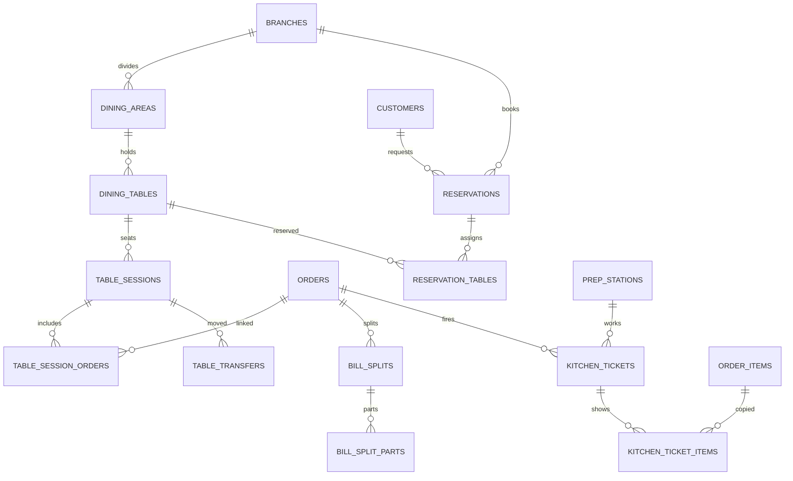
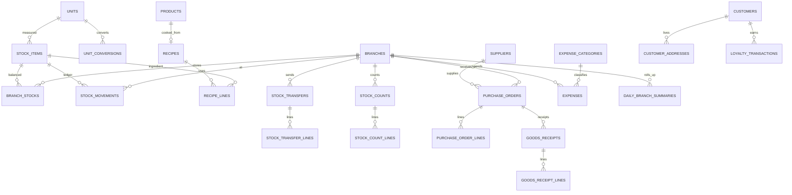
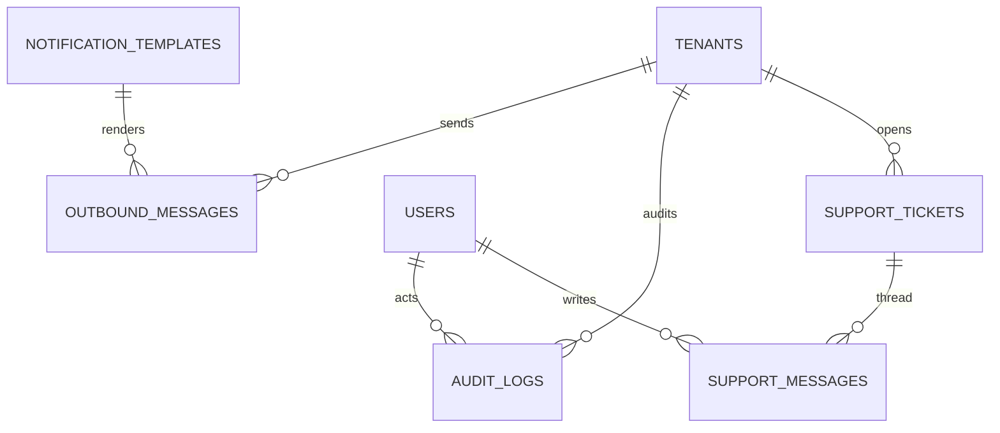

# 05 — مخطط الكيانات والعلاقات

**المشروع:** Restaurant SaaS Platform  
**التاريخ:** 17 نوفمبر 2026  
**المصدر النصي للأعمدة:** [04-database-design.md](04-database-design.md).

مخطط واحد لكل الجداول غير قابل للقراءة. المخططات التالية مقسمة حسب حدود المعاملات. العلاقات المعروضة هي روابط العمل الأساسية. كل جدول تشغيلي ما زال يحمل `tenant_id` حتى لو لم يُرسم السهم إلى `tenants` في المخطط الفرعي لتجنب تكرار الخطوط.

## 1. الاشتراك والهوية

## 2. القائمة

## 3. الطلب والدفع والصندوق

## 4. الصالة والحجز والمطبخ

## 5. المخزون والمشتريات والمالية

## 6. الإشعار والتدقيق

## 7. قواعد لا تظهر في الخطوط

- منع الربط عبر منشأتين يتم بمفتاح أجنبي مركب `(tenant_id, id)` لا بسهم إضافي في الرسم.
- `order_items.product_id` قابل للإفراغ حتى يبقى السطر بعد أرشفة المنتج. النسخة النصية والسعر على السطر هما سجل البيع.
- `stock_movements` لا يُحذف. `branch_stocks.quantity` ملخص.
- `daily_branch_summaries` مشتق من الطلبات والدفعات والمرتجعات ويمكن إعادة بناؤه.
- `loyalty_transactions` مؤجل الإنشاء إلى المرحلة 6 رغم ظهوره في المخطط حتى يبقى شكل البيانات النهائي معروفاً.
